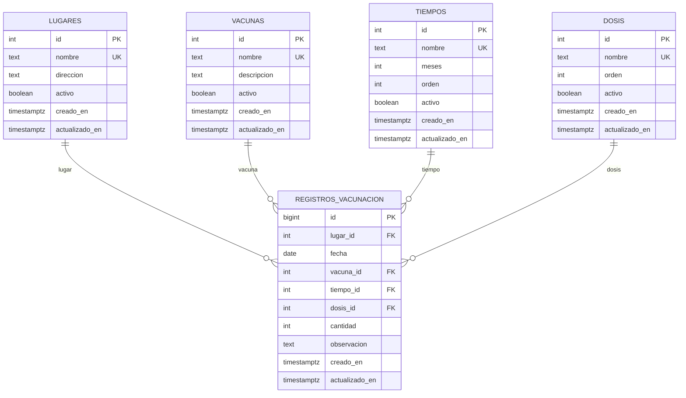

# Base de datos `enfermeria_db`

Base de datos PostgreSQL creada en Neon para registrar y contar vacunas aplicadas.

- **Proyecto Neon:** `hidden-credit-52367644`
- **Branch:** `production` (`br-wispy-recipe-b5anb9t8`)
- **Base de datos:** `enfermeria_db`
- **Motor:** PostgreSQL 18
- **Dueño:** `neondb_owner`

## Modelo entidad-relación



## Tercera Forma Normal (3FN)

El esquema cumple 3FN:

1. **Primera Forma Normal (1FN):** todos los atributos son atómicos. No hay grupos repetidos: los lugares, vacunas, tiempos y dosis viven en catálogos separados, y cada registro de vacunación referencia una fila de cada catálogo.
2. **Segunda Forma Normal (2FN):** todas las tablas tienen clave primaria de una sola columna (`id`), por lo que no existen dependencias parciales de una clave compuesta.
3. **Tercera Forma Normal (3FN):** no hay dependencias transitivas. Los nombres y descripciones de lugares, vacunas, tiempos y dosis se guardan únicamente en su catálogo; la tabla de hechos (`registros_vacunacion`) solo guarda las claves foráneas y los hechos propios del registro (fecha, cantidad, observación). Cambiar el nombre de una vacuna se hace en un solo lugar y no duplica datos.

Los catálogos tienen un índice único sobre `lower(btrim(nombre))` para evitar nombres duplicados sin distinguir mayúsculas/minúsculas ni espacios externos.

### ¿Qué representa `cantidad`?

- Si cada fila representa **una aplicación individual**, deja `cantidad = 1` (valor por defecto).
- Si una fila representa **un lote o jornada** de varias aplicaciones con la misma combinación lugar/fecha/vacuna/tiempo/dosis, usa `cantidad = N`.

El conteo siempre se hace con `SUM(cantidad)`, por lo que ambos casos funcionan.

## Tablas

| Tabla | Propósito |
|---|---|
| `lugares` | Catálogo de lugares donde se aplican las vacunas. |
| `vacunas` | Catálogo de nombres de vacunas. |
| `tiempos` | Catálogo de tiempos del esquema (`1 mes`, `2 meses`, `1 año`, etc.). `meses` normaliza el valor para ordenar y filtrar. |
| `dosis` | Catálogo de dosis (`Primera`, `Segunda`, `Tercera`, `Refuerzo`, etc.). |
| `registros_vacunacion` | Hechos: lugar, fecha, vacuna, tiempo, dosis y cantidad aplicada. |

## Vistas y función de conteo

| Objeto | Resultado |
|---|---|
| `v_conteo_lugar_fecha` | **Conteo principal:** total de vacunas por lugar y fecha. |
| `v_conteo_lugar_fecha_vacuna` | Total por lugar, fecha y vacuna. |
| `v_conteo_lugar_fecha_vacuna_dosis` | Total por lugar, fecha, vacuna, tiempo y dosis. |
| `v_conteo_total_por_fecha` | Total general por fecha. |
| `v_conteo_total_por_lugar` | Total general por lugar. |
| `v_conteo_total_por_vacuna` | Total general por vacuna. |
| `v_conteo_total_por_dosis` | Total general por dosis. |
| `v_registros_detalle` | Detalle completo con los nombres de los catálogos. |
| `contar_vacunas(lugar_id, fecha)` | Función con filtros opcionales para el conteo principal. |

### Consulta principal

```sql
-- Total de vacunas por lugar y fecha
SELECT *
FROM v_conteo_lugar_fecha
ORDER BY fecha DESC, lugar;
```

```sql
-- Total de un lugar y una fecha concretos
SELECT *
FROM contar_vacunas(1, DATE '2026-10-28');
```

## CRUD

Los ejemplos completos están en [`04_crud_examples.sql`](./04_crud_examples.sql).

### Crear un lugar

```sql
INSERT INTO lugares (nombre, direccion)
VALUES ('Centro de Salud Central', 'Av. Principal #123')
RETURNING *;
```

### Actualizar un lugar

```sql
UPDATE lugares
SET nombre = 'Centro de Salud Central (actualizado)'
WHERE id = 1
RETURNING *;
```

### Crear una vacuna

```sql
INSERT INTO vacunas (nombre, descripcion)
VALUES ('BCG', 'Vacuna contra la tuberculosis')
RETURNING *;
```

### Crear un tiempo

```sql
INSERT INTO tiempos (nombre, meses, orden)
VALUES ('5 meses', 5, 5)
RETURNING *;
```

### Crear una dosis

```sql
INSERT INTO dosis (nombre, orden)
VALUES ('Sexta', 6)
RETURNING *;
```

### Registrar vacunas aplicadas

```sql
INSERT INTO registros_vacunacion
    (lugar_id, fecha, vacuna_id, tiempo_id, dosis_id, cantidad, observacion)
VALUES
    (1, DATE '2026-10-28', 1, 1, 1, 10, 'Jornada de vacunación')
RETURNING *;
```

### Actualizar un registro

```sql
UPDATE registros_vacunacion
SET cantidad = 12
WHERE id = 1
RETURNING *;
```

### Eliminar

```sql
DELETE FROM registros_vacunacion WHERE id = 1;
DELETE FROM lugares WHERE id = 1;  -- falla si tiene registros
```

> Los catálogos usan `ON DELETE RESTRICT`. Si un lugar, vacuna, tiempo o dosis ya tiene registros, no se puede borrar. Para “desactivarlo” sin borrar el historial, usa `activo = false`.

## Archivos

| Archivo | Contenido |
|---|---|
| `01_schema.sql` | Tablas, llaves, índices y triggers. |
| `02_views.sql` | Vistas y función de conteo. |
| `03_seed.sql` | Datos iniciales de `dosis` y `tiempos`. |
| `04_crud_examples.sql` | Ejemplos de CRUD y consultas de conteo. |

## Conexión

Usa la cadena de conexión de Neon para la base `enfermeria_db`:

```text
postgresql://neondb_owner:<PASSWORD>@ep-tiny-silence-b58b4pcm-pooler.c-7.us-east-2.aws.neon.tech/enfermeria_db?sslmode=require&channel_binding=require
```

- **Host:** `ep-tiny-silence-b58b4pcm-pooler.c-7.us-east-2.aws.neon.tech`
- **Base de datos:** `enfermeria_db`
- **Usuario:** `neondb_owner`
- **SSL:** `require`

La contraseña se obtiene en el panel de Neon o con la herramienta `get_connection_string` del MCP de Neon. No guardes la contraseña en el repositorio.
